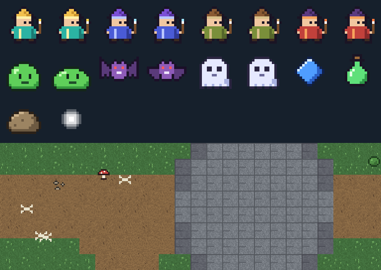

# 픽셀 아트

캐릭터·몬스터·아이템·배경은 `ArtSource/generate_art.py`의 픽셀 템플릿과 고정 시드로 생성합니다.



Python과 Pillow를 설치한 뒤 프로젝트 폴더에서 실행합니다.

```sh
python -m pip install Pillow
python ArtSource/generate_art.py
```

결과는 `Assets/StreamingAssets/Art`에 저장됩니다. 게임은 PNG를 Point 필터로 불러옵니다. 배경 JSON에는 타일·장식 배치가 들어 있으며, 장애물 판정에는 사용하지 않습니다.

캐릭터 4종과 몬스터 3종은 각각 2프레임 애니메이션을 사용합니다. 몬스터 외형은 능력치 차이를 의미하지 않습니다. 공격 범위와 일부 효과는 Unity 기본 도형으로 표시합니다.
