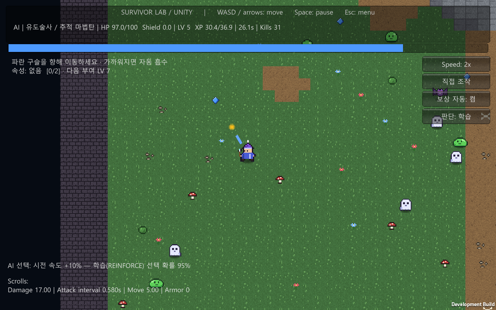
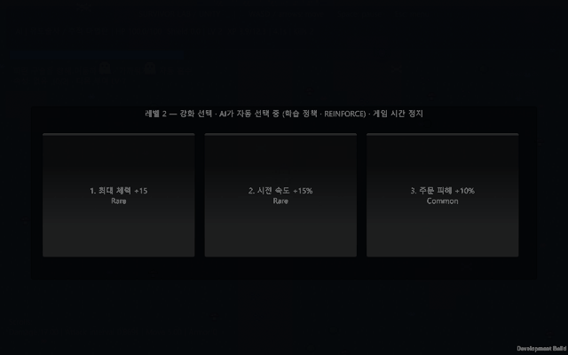

# Survivor Lab

몰려오는 적을 피하면서 5분 동안 살아남는 게임입니다. Unity로 만들었고, 직접 플레이하거나 AI가 플레이하는 걸 지켜볼 수 있습니다.





위 화면은 AI가 플레이하는 장면을 2배속으로 녹화한 것입니다. [MP4 영상](docs/media/gameplay.mp4)도 있습니다. GitHub에서 바로 재생되지 않으면 다운로드해서 보세요.

## 바로 해보기

1. [Releases](https://github.com/shinkm1104/survivor-lab-unity/releases/latest)에서 ZIP 파일을 받습니다.
2. 압축을 풀고 `SurvivorLab.exe`를 실행합니다.

압축을 푼 폴더 안의 파일은 다른 곳으로 옮기지 말고 그대로 두세요. exe 파일만 따로 꺼내면 실행되지 않습니다. 지금은 Windows 64비트만 지원합니다.

## 조작

| 키 | 하는 일 |
|---|---|
| WASD 또는 방향키 | 이동 (공격은 자동) |
| 1, 2, 3 또는 마우스 클릭 | 레벨업 보상 고르기 |
| Space | 일시 정지 / 다시 시작 |
| Esc | 메뉴로 |

다른 창을 누르면 게임이 멈춥니다. 돌아와서 Space를 누르면 이어서 할 수 있습니다.

## 게임 방법

시작할 때 마법사 네 명 중 하나를 고릅니다. 마법사마다 공격 방식이 다릅니다.

| 마법사 | 공격 |
|---|---|
| 공명술사 | 내 주변에 동그란 파동을 퍼뜨립니다 |
| 유도술사 | 가장 가까운 적에게 마법탄을 쏩니다 |
| 각인술사 | 지나간 자리에 돌을 남기고, 돌에 닿은 적이 피해를 입습니다 |
| 충격술사 | 마지막으로 움직인 방향 앞쪽으로 충격파를 날립니다 |

적을 쓰러뜨리면 파란 구슬(경험치)이 떨어집니다. 구슬을 모아 레벨이 오르면 강화 카드 3장 중 하나를 고릅니다.

- 레벨 7과 14에는 공격에 속성을 붙입니다. 화염, 번개, 산성, 냉기, 암흑 중에서 고르고, 같은 속성을 두 번 고르거나 서로 다른 속성을 섞을 수 있습니다.
- 1분마다 특수 효과가 있는 두루마리를 하나 고릅니다.
- 30초마다 웨이브가 바뀌면서 적이 많아지고, 빨라지고, 단단해집니다. 박쥐는 빠른 적이고, 유령은 줄지어 맵을 쓸고 지나갑니다. 유령 줄에는 빈틈이 하나 있습니다.
- 300초를 버티면 승리합니다.

## AI 관전

메뉴에서 마법사를 고르고 **WATCH AI**를 누르면 AI가 대신 플레이합니다. 이동도 보상 선택도 AI가 알아서 하니까 지켜보기만 하면 됩니다.

- 이동은 강화학습(Q-learning)으로 학습한 정책을 씁니다.
- 보상 카드는 따로 학습한 정책(REINFORCE)으로 고릅니다. 화면 오른쪽 `판단` 버튼을 누르면 미리 정해둔 규칙으로 고르게 바꿀 수 있습니다.
- `보상 자동`을 끄면 이동은 AI가 하고 카드는 내가 고릅니다.
- 게임 중에 `직접 조작` 버튼을 누르면 바로 내가 조종할 수 있습니다.
- 메뉴의 `TRAIN +400 episodes`는 이동 AI를 400판 더 학습시킵니다. 보상 선택 AI는 학습시키지 않습니다.

AI가 항상 이기지는 않습니다. 웨이브 시스템을 넣은 뒤로는 공명술사 말고는 자주 집니다. 이동 AI가 예전 규칙에 맞춰 학습된 것이라서 그렇습니다. 이유는 [밸런스 보고서](docs/reports/balance-report.md)에 정리했습니다.

추가로 학습한 이동 AI는 `%USERPROFILE%\AppData\LocalLow\Independent Lab\Survivor Lab\policy-v2.json`에 저장됩니다. 이 파일을 지우면 처음 들어 있던 AI로 돌아갑니다.

## 밸런스 측정 결과

여러 플레이 방식으로 총 984판을 자동으로 돌려봤습니다. 아래 표는 그중 피하면서 싸우는 단순한 봇과 게임에 들어 있는 AI로 플레이한 판(마법사마다 40판)의 생존율입니다.

| | 공명술사 | 유도술사 | 각인술사 | 충격술사 |
|---|---:|---:|---:|---:|
| 피하면서 싸우는 봇 | 60% | 80% | 35% | 25% |
| 게임 AI | 77.5% | 20% | 5% | 0% |

웨이브 시스템을 넣기 전에는 어떤 마법사든 도망만 다니면 100% 이겼습니다. 지금은 그렇게는 이길 수 없습니다. 자세한 내용, 실패한 판을 그대로 다시 돌려본 기록, 개선 방향은 [보고서](docs/reports/balance-report.md)에 있습니다.

## 직접 빌드하기

필요한 것은 Unity **6000.0.74f1**과 Windows Build Support 모듈입니다. Unity Hub에서 설치하세요.

```bat
open-unity.cmd      :: Unity 에디터로 프로젝트 열기
build.cmd --verify  :: 게임 규칙 테스트만 실행
build.cmd           :: Builds\Windows 에 실행 파일 만들기
play.cmd            :: 빌드한 게임 실행
balance.cmd         :: 밸런스 측정 (결과는 docs\reports\data)
```

Unity를 다른 경로에 설치했다면 `UNITY_EDITOR` 환경 변수에 `Unity.exe`의 전체 경로를 넣어주세요. 빌드할 때마다 게임 규칙 테스트가 먼저 돌고, 로그는 `Logs/build.log`에 남습니다.

실패한 판을 다시 보고 싶으면 `balance.cmd --replay 클래스 시드`를 실행하세요. 예를 들어 `balance.cmd --replay 3 90210`은 충격술사 AI가 36.4초에 죽는 판을 똑같이 다시 돌리고, 2초마다 체력과 주변 적 수를 출력합니다.

### 코드 위치

| 파일 | 내용 |
|---|---|
| `Assets/Scripts/Simulation.cs` | 전투, 레벨업, 보상 |
| `Assets/Scripts/ElementEffects.cs` | 속성 효과 |
| `Assets/Scripts/GameApp.cs` | 입력, 화면, UI |
| `Assets/Scripts/Learning.cs` | 이동 AI 학습 |
| `Assets/Scripts/RewardLearning.cs` | 보상 선택 AI |
| `Assets/Editor/BalanceLab.cs` | 밸런스 측정, 실패 재현 |
| `Assets/StreamingAssets/balance.json` | 체력, 속도, 피해량 같은 수치 |
| `ArtSource/` | 픽셀 아트 생성 스크립트 ([ART.md](ART.md)) |

`balance.json`의 수치를 바꾸면 이미 학습된 AI가 예전만큼 잘 못할 수 있습니다. 바꾼 뒤에는 `balance.cmd`로 다시 측정해 보세요.
